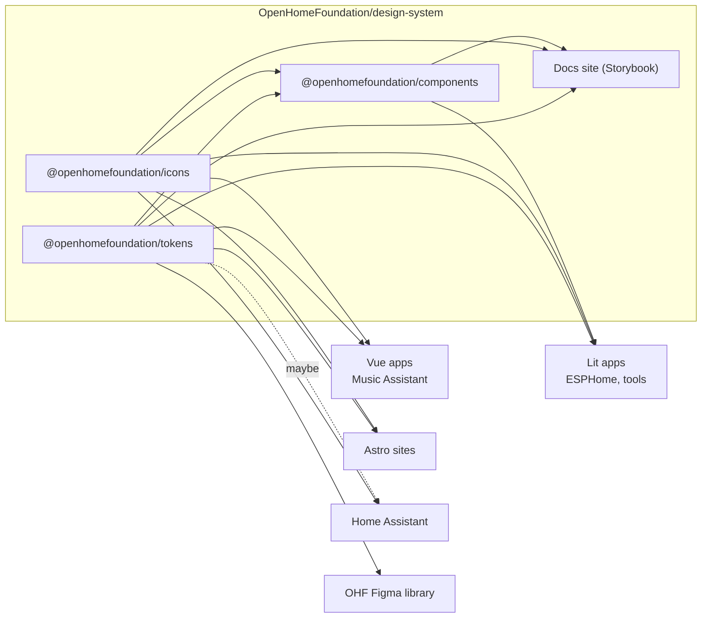
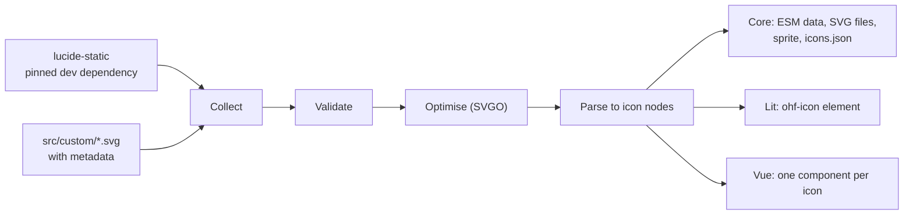

# 0001. OHF design system: tokens, icons and Lit components

Date: 2026-11-05

Author: Steven Travers

## Status

Proposed.

Comment on any section, or reply to the [open questions](#open-questions) by number ("Q3: agree", "Q1: prefer Lion because …").

OHF has no ADR process yet, so this ADR uses the format from [home-assistant/architecture](https://github.com/home-assistant/architecture/blob/master/EMPTY-ADR.md) (Context, Decision, Consequences). It adds sections for the options we considered, the rollout and the open questions.

## Summary

- One repo, `OpenHomeFoundation/design-system`, publishes three npm packages: `@openhomefoundation/tokens`, `@openhomefoundation/icons` and `@openhomefoundation/components`.
- **Tokens** are written once in the W3C design tokens format (DTCG). Style Dictionary turns them into CSS variables, JS, a Lit stylesheet, a Tailwind theme and JSON for Figma.
- **Icons** are all of Lucide plus our own SVGs. One generator script turns every SVG into framework-free JS and SVG, a Lit element and Vue components. A new Lucide release or a new OHF SVG leads to a new package release with no manual steps beyond merging a PR.
- **Components** are Lit web components with an `ohf-` prefix. OHF owns their public API. Inside, they build on Web Awesome, the library HA's own components use, behind tests that let us swap the base later without breaking apps.
- This ADR decides how we build and ship the design system, not what it looks like. Colours, type and shapes come from [roadmap #29](https://github.com/OpenHomeFoundation/roadmap/issues/29), the visual language for OHF products.
- **Who uses what.** Home Assistant will use the icons, may adopt the tokens later, and keeps its own `ha-*` components. Music Assistant uses tokens and icons. ESPHome, the web tools and the websites can use all three.

## Context

### The problem

Each OHF frontend defines its own colours, spacing, buttons and icons:

| Project | Stack | Tokens | Icons |
|---|---|---|---|
| Home Assistant frontend | Lit, Web Awesome fork | `--ha-*` core and semantic tokens | MDI (`@mdi/js`) |
| ESPHome Device Builder dashboard | Lit 3, legacy `@material/mwc-*` | none shared | MDI |
| Music Assistant | Vue 3, shadcn-vue, Tailwind v4 | own CSS variables | Lucide (`@lucide/vue`) |
| OHF websites | Astro | per site | per site |

The same OHF blue (`#18BCF2`) is typed by hand in several repos. Every new app starts its button, dialog and icon setup from zero, and accessibility fixes made in one app don't reach the others.

### What already exists

- **Engineering standards** ([technologies.md](https://github.com/OpenHomeFoundation/engineering-standards/blob/main/src/content/docs/standards/technologies.md), internal) list "UI Component Library: TBD, framework-agnostic component library is under evaluation". They also prefer "Astro with small components sprinkled in", and web components fit that well. This ADR proposes how to fill that gap.
- **Visual language:** [roadmap #29](https://github.com/OpenHomeFoundation/roadmap/issues/29) defines colour, typography, iconography, shape and spacing for OHF products, and explicitly leaves out the component library. [#127](https://github.com/OpenHomeFoundation/roadmap/issues/127) picks HomeCore as HA's visual language and "the base for other OHF products". That work happens inside the HA frontend, and its decision log leaves applying it to other OHF products to #29.
- **Brand assets:** [brand-assets](https://github.com/OpenHomeFoundation/brand-assets) holds logos only, with no colours, tokens or icons. The brand palette lives in the brands site (`src/lib/colors.ts`, internal): Light Blue `#18BCF2`, Dark Blue `#09293B`, Dark Grey `#5A6675`, Grey `#A2AAB6` and Light Grey `#F7F6F2`. Light Blue is the same value as HA's `--ha-color-primary-50`.
- **HA's token model** ([src/resources/theme](https://github.com/home-assistant/frontend/tree/dev/src/resources/theme)) is the most complete one we have:
  - Core colour ramps (`--ha-color-{primary,neutral,orange,red,green}-{05…95}`), marked as not for direct use in components.
  - Semantic colours such as `--ha-color-fill-primary-normal-resting`, `--ha-color-border-neutral-quiet` and `surface-*`, with light and dark sets.
  - `--ha-space-1…20` on a 4px grid, radii from `sm` to `6xl`, and a typography scale.
- **Figma:** [ux-design/design-kit](https://github.com/OpenHomeFoundation/ux-design/tree/main/design-kit) generates the HA Design Kit (549 variables) from those HA theme files, and has Code Connect templates ready.
- **Web Awesome in HA:** the HA frontend depends on [`@home-assistant/webawesome`](https://github.com/home-assistant/webawesome) (3.14.0-ha.2, a fork of Web Awesome, MIT). About 30 `ha-*` components subclass it, for example `class HaButton extends Button`, and `--wa-*` variables are mapped to `--ha-*`.

### Requirements

1. Tokens and icons work in any stack: Lit, Vue, Astro and plain HTML.
2. Components are written in Lit, since most OHF apps are Lit.
3. Components are accessible by default (keyboard, screen readers, focus, forms).
4. Each product can theme the system (brand, light and dark) without forking components.
5. Icons cover all of Lucide plus OHF-made icons, stay up to date with Lucide, and one generator builds them for every target.
6. A small team can maintain it, following the engineering standards wherever they apply.
7. Anyone can `npm install` the packages without a token, including community contributors.

## Decision

### Overview



Lit apps can use all three packages. Vue apps and Astro sites use tokens and icons, and Astro sites can drop in components as islands. Home Assistant uses the icons; the dotted line marks the tokens it may adopt later. It keeps its own components. An OHF Figma library is generated from the tokens JSON.

### 1. Repository and tooling

```
design-system/
├── packages/
│   ├── tokens/        @openhomefoundation/tokens
│   ├── icons/         @openhomefoundation/icons
│   └── components/    @openhomefoundation/components
├── apps/docs/         Storybook site
├── script/            setup, test, cibuild (mise tasks)
└── .github/           CI, Release Please, Renovate
```

- **Stack:** pnpm workspace, TypeScript strict and Node LTS, set up with mise and a `script/` folder. ESLint, Prettier, commitlint with Conventional Commits, Husky with lint-staged, and signed commits. All of this follows the [engineering standards](https://github.com/OpenHomeFoundation/engineering-standards).
- **Releases:** [Release Please](https://github.com/googleapis/release-please) in manifest mode. Each package gets its own version and changelog, and a commit counts towards the packages whose files it changes.
- **Publishing:** to npmjs.org under `@openhomefoundation`, with [npm trusted publishing](https://docs.npmjs.com/trusted-publishers) from GitHub Actions, so every release carries provenance.
  - Not GitHub Packages, which `astro-hubspot-forms` uses today. Installing from GitHub Packages needs an auth token even for public packages, which would block community contributors and anyone building our apps from source.
- **Tests:** Vitest. Component tests run in Vitest browser mode with Playwright in real Chromium, Firefox and WebKit, with axe accessibility checks. The token build and the icon generator get unit and snapshot tests.
  - This is a deliberate exception to the Jest standard. Shadow DOM, focus handling and form-associated elements need a real browser, and jsdom doesn't provide one.
- **Docs:** Storybook 10 (`@storybook/web-components-vite`) is deployed on every merge to main, with previews on PRs.
  - Component pages are generated from the Custom Elements Manifest.
  - Token pages show colour ramps, semantic tokens, spacing and type.
  - An icon gallery searches names and tags.
- **Licence:** Apache-2.0, the OHF default. The icons package also ships Lucide's licence (see [Icons](#3-icons-openhomefoundationicons)).

### 2. Tokens: `@openhomefoundation/tokens`

The source is [DTCG 2025.10](https://www.w3.org/community/design-tokens/2025/10/28/design-tokens-specification-reaches-first-stable-version/) `.tokens.json` files. [Style Dictionary 5](https://styledictionary.com/) builds them.

```
packages/tokens/src/
├── primitive/   color, space, radius, typography, motion
├── semantic/    text, surface, border, fill (quiet/normal/loud × resting/hover/active)
├── themes/      light, dark
└── brands/      ohf, music-assistant, esphome
```

| Tier | Example token | Used by |
|---|---|---|
| Primitive | `color.primary.50`, `space.4`, `radius.md` | semantic tokens only |
| Semantic | `color.fill.primary.normal.resting`, `color.text.secondary` | components and apps |
| Theme | light and dark point semantic tokens at different primitives | the build |
| Brand | overrides primary ramps, fonts and radii per product | the build |

The semantic tier reuses the model HA designed (quiet/normal/loud fills and borders, surfaces) rather than inventing a new one. Sharing the model means HA could adopt these tokens later without a redesign.

| Output | Import | For |
|---|---|---|
| CSS custom properties `--ohf-*` | `@openhomefoundation/tokens/css/tokens.css`, `/css/themes/dark.css`, `/css/brands/*.css` | every stack |
| ESM and `.d.ts` | `@openhomefoundation/tokens` | JS logic, charts |
| Lit `CSSResult` | `@openhomefoundation/tokens/lit` | adopted stylesheets in Lit apps |
| Tailwind v4 `@theme` file | `@openhomefoundation/tokens/tailwind.css` | Tailwind apps such as MA |
| Resolved JSON | `@openhomefoundation/tokens/tokens.json` | Figma Design Kit, docs |

```html
<html data-theme="dark" data-brand="music-assistant">
```

```css
@import "@openhomefoundation/tokens/css/tokens.css";

.card {
  background: var(--ohf-color-surface-raised);
  padding: var(--ohf-space-4);
}
```

`data-theme` takes `light`, `dark` or `auto` (follows `prefers-color-scheme`). `data-brand` selects a brand file.

Rules:

- **Values are owned by UX** through #29, not by this ADR. Version 0 starts from the OHF brand palette, with colour ramps generated from it.
- **HA may adopt the tokens later; that's HA's decision.** If it does, it can switch gradually by pointing its variables at ours (`--ha-color-primary-50: var(--ohf-color-primary-50)`), the same way it maps `--wa-*` to `--ha-*` today. A `home-assistant` brand file would be added then, and the HA Design Kit could build from `tokens.json` too.
- **The repo is the source of truth and Figma follows.** An OHF Figma library is generated from `tokens.json`, the same way `ux-design` generates the HA Design Kit from HA's theme files today. Designers propose changes as PRs, or later through a Tokens Studio sync. Token PRs need a UX code owner's review.
- **Renaming or removing a token is a breaking change** (major version). The old name stays for one major, marked with DTCG's `$deprecated`.

### 3. Icons: `@openhomefoundation/icons`

**Sources**

- **Lucide:** [`lucide-static`](https://www.npmjs.com/package/lucide-static), pinned as a dev dependency. Version 1.69.0 ships 2,024 icons as SVG files, plus `tags.json`, `icon-nodes.json` and its licence.
- **OHF:** `packages/icons/src/custom/<name>.svg`, each with a `<name>.json` in Lucide's metadata shape (tags, categories, aliases). Custom icons follow Lucide's drawing rules (24×24 grid, 2px stroke, round caps and joins, no fills) so the two sets mix. This is where OHF-specific icons go, such as device or protocol glyphs. Since HA uses this package, it's also a natural home for HomeCore's new icon pack ([#127](https://github.com/OpenHomeFoundation/roadmap/issues/127)).

**Generator**



- `scripts/build.ts` collects both sources, validates, optimises, and parses each SVG into icon nodes (`[["path", { d: "…" }], …]`, the same shape Lucide uses).
- Validation checks the 24×24 viewBox, the stroke attributes, that there are no fills or inline styles, that names are kebab-case, and that no custom name clashes with a Lucide name.
- Each target is one template module (`templates/core.ts`, `templates/lit.ts`, `templates/vue.ts`) that receives `{ name, componentName, node, tags }`. Adding React later means adding `templates/react.ts`.
- Generated files go to `dist/` during CI and publish, and are not committed.

**Outputs**

`vue` and `lit` are optional peer dependencies, so each app only installs what it uses.

| Export | Contents |
|---|---|
| `@openhomefoundation/icons` | One tree-shakeable ESM export of icon nodes per icon (`iconHouse`), plus `icons.json` metadata (name, tags, aliases, source) |
| `@openhomefoundation/icons/svg/*.svg`, `/sprite.svg` | Optimised SVG files and a sprite, for sites with no build step |
| `@openhomefoundation/icons/lit` | One `<ohf-icon>` element that takes icon data, plus a `renderIcon()` helper for use inside other Lit templates |
| `@openhomefoundation/icons/vue` | One generated component per icon, with the same names and props as `@lucide/vue` (`size`, `color`, `strokeWidth`, `absoluteStrokeWidth`) |

```ts
// Any stack: icon data only
import { iconHouse } from "@openhomefoundation/icons";

// Lit
import "@openhomefoundation/icons/lit/define.js"; // registers <ohf-icon>
html`<ohf-icon .icon=${iconHouse} label="Home"></ohf-icon>`;

// Vue
import { House } from "@openhomefoundation/icons/vue";
// <House :size="20" />
```

- Lit gets one element rather than one element per icon, which would register over 2,000 custom element tags.
- Vue keeps Lucide's names, so a Vue app can switch by changing its import path.
- Icons are hidden from screen readers by default. Setting `label` gives them `role="img"` and an accessible name.

**In Home Assistant**

HA renders MDI icons today. `ha-svg-icon` draws a single filled path string from `@mdi/js`, and `ha-icon` looks up names such as `mdi:lightbulb` in an icon database that also accepts custom sets. Lucide-style icons are several stroked shapes, so HA needs a different renderer for them:

- **In HA's own code:** use `<ohf-icon>` from `@openhomefoundation/icons/lit`, or teach `ha-svg-icon` to draw icon nodes.
- **For icons users pick in the UI or in YAML:** HA can register the set under its own prefix (for example `ohf:house`) from `icons.json` and the per-icon data, next to `mdi:`.

MDI stays, because users' dashboards and configs reference `mdi:` names.

**How a new SVG becomes a release**

- **New OHF icon:**
  1. A PR adds the SVG and its JSON.
  2. CI validates it and the docs preview shows it.
  3. The PR merges as `feat(icons): add <name>`.
  4. Release Please opens a release PR, and merging it publishes a minor version.
- **New Lucide release:**
  1. Renovate opens a PR bumping `lucide-static`. Lucide releases almost daily, so updates are grouped weekly and must be at least 7 days old, as the engineering standards require. The commit type is `feat`.
  2. CI runs the generator and comments the list of added, renamed and removed icons on the PR.
  3. Merging the PR leads to a minor release.
  4. If Lucide removes an icon (rare; v1 removed its brand icons), the release is a major. A renamed icon keeps its old name as a deprecated alias, using Lucide's alias metadata.
- **Licence:** Lucide is ISC, plus MIT for the icons that come from Feather. Both notices must ship with copies, so the package includes Lucide's licence file next to Apache-2.0 for OHF icons.

### 4. Components: `@openhomefoundation/components`

**OHF owns the API.** The public contract of each `ohf-*` element is ours, and apps never depend on the internals of a base library. That contract covers:
- the tag name
- attributes and properties
- slots
- `::part()` names
- states
- events
- CSS custom properties

**The internals build on Web Awesome** (`@awesome.me/webawesome`) where it has the component. Where it has no fitting component, we write our own Lit code.
- `--wa-*` variables are mapped to `--ohf-*` tokens once, in a shared stylesheet, the way HA maps them to `--ha-*`.
- Contract tests on each `ohf-*` element cover rendering, keyboard use, accessibility and form submission. They let us swap the base for one component (to Lion or our own code) without breaking apps.
- Why Web Awesome: it's already proven at OHF (HA ships about 30 components on it), so many of our frontend developers know it. Its accessibility work is mature, and it is MIT-licensed. [Lion](https://lion.js.org/) is the runner-up (see [Considered options](#considered-options)).

**Conventions**, borrowing from [Bits UI](https://www.bits-ui.com/docs/components/button) and Lion:

- **Names:** tags start with `ohf-` and classes with `Ohf` (`ohf-button`, `OhfButton`).
- **Styling:** components read semantic tokens only, never primitives. Documented per-component variables (`--ohf-button-radius`) and `::part()` names are the escape hatches.
- **State:** shown through reflected attributes (`disabled`, `loading`, `variant`) and custom states (`:state(pressed)`), the web-component version of Bits UI's `data-state`.
- **Links:** `href` renders a real `<a>`, as in Bits UI's Button.
- **Forms:** form controls are form-associated through `ElementInternals` (value, validity, reset, disabled).
- **Accessibility:** WAI-ARIA Authoring Practices patterns, with keyboard and axe tests in real browsers for every component.
- **Events:** native event names where one exists (`click`, `input`, `change`), otherwise prefixed with `ohf-`.
- **Shared vocabulary:** variant and size names are the same across components and listed in the docs.

**Packaging**

```ts
// Register the default tag
import "@openhomefoundation/components/define/ohf-button.js";

// Or import the class and register your own tag, so two bundled versions on one page don't clash
import { OhfButton } from "@openhomefoundation/components/button.js";
customElements.define("my-card-button", class extends OhfButton {});
```

- The second form matters when two bundles on one page carry different versions, for example an app and an embedded widget.
- A generated [Custom Elements Manifest](https://custom-elements-manifest.open-wc.org/) drives the docs, editor hints and Vue/JSX type declarations.

**Pilot:** `ohf-button` and `ohf-icon-button` (plus `ohf-icon` from the icons package), used in one small Lit app before we add more. After that, the next components come from what the pilot apps need: switch, checkbox, text field, dialog, tooltip.

**Out of scope:**
- Home Assistant keeps its own `ha-*` components. It uses the icons, and the tokens only if it decides to.
- Music Assistant (Vue) uses tokens and icons only.

## Considered options

### Components

| Option | For | Against |
|---|---|---|
| A. Own headless primitives from scratch, Bits UI style | Full control over API and output | Highest accessibility cost; slowest to a first usable component |
| B. Build on [Lion](https://github.com/ing-bank/lion) (`@lion/ui` 0.26, MIT) | Best accessibility and form system; white-label by design | Pre-1.0 with frequent breaking minor releases; needs the scoped custom element registry polyfill; styling by subclassing exposes its internals |
| C. Use Web Awesome directly (`wa-*` tags) | Fastest start | A vendor's API and tag names become ours; styled first; the roadmap belongs to a commercial company |
| **D. Own `ohf-*` API, built on Web Awesome (recommended)** | Proven at OHF through HA; fast; the base can be swapped per component | We maintain a mapping layer and keep up with Web Awesome releases |

### Token build

| Option | For | Against |
|---|---|---|
| **Style Dictionary 5 (recommended)** | Most used by far; Apache-2.0; DTCG support built in; CSS, JS, TS and custom formats | Full 2025.10 support is still in progress |
| Terrazzo 2 | Stricter DTCG, built-in linting, Tailwind plugin | Much smaller ecosystem |
| Hand-written CSS variables | No build step | No JS, Tailwind or Figma outputs; values drift |

### Icons

| Option | For | Against |
|---|---|---|
| **Generate from Lucide SVGs ourselves (recommended)** | One pipeline for Lucide and OHF icons; a Lit target exists; we control names and accessibility | We maintain a generator of a few hundred lines |
| Iconify runtime (`@iconify/vue`, `iconify-icon`) | No code generation | Extra runtime; custom icons need separate tooling |
| `unplugin-icons` in each app | Nothing to publish | Every app configures a bundler plugin; no help for sites without a build; custom icons get copied around |
| Depend on `@lucide/*` per framework | No work | No Lit package ([lucide-lit was declined](https://github.com/lucide-icons/lucide/pull/4307) in May 2026); nowhere to put OHF icons |

### Repo shape

| Option | For | Against |
|---|---|---|
| **One monorepo (recommended)** | A change that spans packages (a new token used by a component) lands in one PR; one CI and release setup | Wider CODEOWNERS setup |
| One repo per package | Separate permissions per package | Wrappers fall behind: Phosphor's separate web-component repo hasn't published since 2024 |

## Consequences

**What we gain**

- One icon set across every OHF product, HA included.
- One source of truth for colours, spacing and type across ESPHome, MA, the tools and the websites, instead of copied hex values.
- Figma follows the repo, so design and code stop drifting.
- New OHF apps start with accessible buttons, icons and themes on day one.
- Accessibility fixes land once and reach every app.
- Lucide updates arrive as a reviewed weekly PR, with no manual copying.

**What it costs**

- Someone has to own it. Each package needs named maintainers and review time.
- Breaking changes need coordination across apps that release on different schedules.
- Custom element tags can clash when two versions load on one page. The class export and own-tag registration reduce the risk; scoped custom element registries will remove it once every browser ships them.
- HA and the other OHF apps use two separate component systems (`ha-*` and `ohf-*`), so component fixes don't flow between them. Until HA decides on the tokens, keeping our colours close to HA's is a manual check.
- HA will show MDI and OHF icons side by side for a long time, since users' configs reference `mdi:` names. Filled MDI icons next to stroked Lucide-style ones is a visual mix HA's designers need to plan for.
- We depend on Web Awesome's direction. The contract tests keep that dependency swappable.

## Rollout

| Phase | Delivers | Done when |
|---|---|---|
| 0 | ADR accepted; repo, npm scope, CI, Release Please, Renovate, docs skeleton | A canary version publishes from CI with provenance |
| 1 | Icons | HA renders its first icons from the package, and a Vue app can replace `@lucide/vue` by changing imports |
| 2 | Tokens v0, from the brand palette | A pilot app uses the tokens, and an OHF Figma library builds from `tokens.json` |
| 3 | Components pilot | `ohf-button` and `ohf-icon-button` ship in one Lit app |
| 4 | Wider adoption | Other OHF apps and sites adopt; new components follow what they need |

Icons go first because they stand alone and HA can use them right away.

## Open questions

Each question has a proposed default. Silence means agreement.

1. **Component base:** D (own API on Web Awesome) or B (Lion)? *Default: D.*
2. **Which Web Awesome:** upstream `@awesome.me/webawesome` or HA's fork? *Default: upstream, so we don't depend on HA's release cycle. Fork only if we hit a bug upstream won't fix.*
3. **npm scope and registry:** `@openhomefoundation/*` on npmjs.org? Someone with org rights needs to confirm or claim the npm org. *Default: yes.*
4. **Package names:** `tokens`, `icons`, `components` (or `ui`)? *Default: `components`.*
5. **Repo visibility:** `OpenHomeFoundation/design-system` is internal today, but this plan assumes a public repo: community contributions, and npm only adds provenance to packages published from public repos. *Default: make it public before the first release.*
6. **Prefixes:** `ohf-` for tags and `--ohf-` for CSS variables, or a dedicated system name? *Default: `ohf-`.*
7. **Token values:** UX owns them through #29, the repo is the source of truth and Figma follows? *Default: yes.*
8. **Brand marks in the icon set:** should HA, MA and ESPHome logomarks ship as icons? They are trademarks, and Lucide dropped brand icons in v1 for that reason. *Default: no; logos stay in brand-assets.*
9. **Pilot app:** which Lit app tries the components first? *Default: the smallest Lit app whose team volunteers.*
10. **Maintainers:** who owns each package? *Default: two frontend maintainers per package in CODEOWNERS, plus UX for tokens and icons.*
11. **Testing:** Vitest browser mode instead of the Jest standard? *Default: yes, recorded as an exception to the engineering standards.*
12. **Browser support:** *Default: the last two major versions of Chrome, Edge, Firefox and Safari.*
13. **Lucide sync cadence:** *Default: weekly Renovate PR, releases at least 7 days old.*
14. **HA and the tokens:** does HA adopt them, and when? *Default: decide once tokens v0 exists. The token design keeps the option open.*
15. **How HA uses the icons:** `<ohf-icon>` in its own code, an `ohf:` set in its icon database for users, or both? *Default: both.*

## References

- Engineering standards, [technologies](https://github.com/OpenHomeFoundation/engineering-standards/blob/main/src/content/docs/standards/technologies.md) and [quality and CI/CD](https://github.com/OpenHomeFoundation/engineering-standards/blob/main/src/content/docs/standards/quality-cicd.md) (internal)
- Roadmap [#29 Visual design language for OHF products](https://github.com/OpenHomeFoundation/roadmap/issues/29) and [#127 HomeCore](https://github.com/OpenHomeFoundation/roadmap/issues/127)
- [OpenHomeFoundation/brand-assets](https://github.com/OpenHomeFoundation/brand-assets), [ux-design Design Kit](https://github.com/OpenHomeFoundation/ux-design/tree/main/design-kit)
- HA frontend [theme tokens](https://github.com/home-assistant/frontend/tree/dev/src/resources/theme), [ha-button on Web Awesome](https://github.com/home-assistant/frontend/blob/dev/src/components/ha-button.ts), [home-assistant/webawesome](https://github.com/home-assistant/webawesome)
- [Lion button](https://lion.js.org/components/button/overview/), [Bits UI button](https://www.bits-ui.com/docs/components/button), [Web Awesome](https://webawesome.com/)
- [Lucide](https://lucide.dev/) ([licence](https://lucide.dev/license), [version 1](https://lucide.dev/guide/version-1)), [lucide-static on npm](https://www.npmjs.com/package/lucide-static)
- [DTCG 2025.10](https://www.w3.org/community/design-tokens/2025/10/28/design-tokens-specification-reaches-first-stable-version/), [Style Dictionary](https://styledictionary.com/), [Terrazzo](https://terrazzo.app/)
- [Release Please](https://github.com/googleapis/release-please), [npm trusted publishing](https://docs.npmjs.com/trusted-publishers), [Custom Elements Manifest](https://custom-elements-manifest.open-wc.org/)
